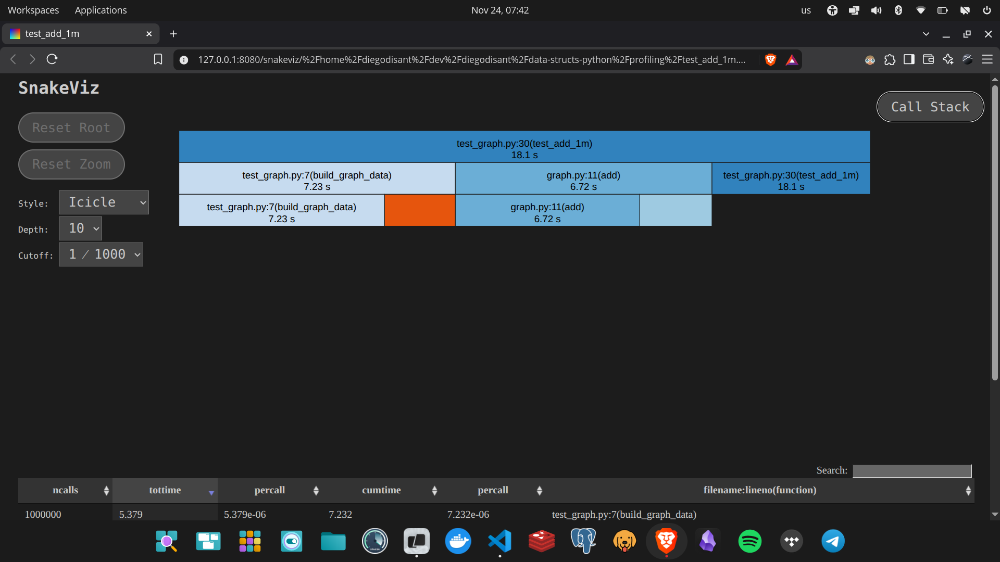

# data-structs-python
Learning Data Structures in Python

## Setup

**Dependencies:**

[Pyenv](https://github.com/pyenv/pyenv)

```sh
pyenv install 3.13.1t
virtualenv -p python3.13.1 .venv
source .venv/bin/activate
pip3 install requirements.txt
```

**Tasks** are handled by [just](https://github.com/casey/just) (the `PYTHONPATH` is exported automatically by the justfile):

```sh
just              # list all available recipes
just setup        # install pinned dependencies (requirements.txt)
just lint         # run pylint over structs/ and tests/
```

## Testing

```sh
just test                                       # run the whole test suite
just test-single <test_name>                    # run a single test by name
just test-coverage                              # run tests with a coverage report
just test-memory <test_path> <test_name>        # run a test under the memory profiler
```

### Current Coverage (92%)


## Profiling

Profile at: `tests/struct/test_struct.py`

```python
from tests.profiler import profile_test

@profile_test
def benchmark_test() -> None:
  # some code stub
  pass
```

Run your test

```sh
just test-single benchmark_test
```

Open your profile

```sh
just open-profile benchmark_test
```



## Data Structures

Every data structure covered here, with the module that implements it and its core operations:

| Data Structure | Module | Core Operations |
| -------------- | ------ | --------------- |
| Single Linked List | [`structs/list/single/`](structs/list/single/) | `insert`, `delete`, `contains`, `is_empty`, `calc_size` |
| Double Linked List | [`structs/list/double/`](structs/list/double/) | `insert`, `delete`, `contains`, `parallel_search`, `is_empty`, `calc_size` |
| Queue | [`structs/queue/`](structs/queue/) | `enqueue`, `dequeue`, `at_start`, `at_end`, `is_empty` |
| Stack | [`structs/stack/`](structs/stack/) | `push`, `pop`, `is_empty` |
| Binary Search Tree | [`structs/tree/`](structs/tree/) | `insert`, `traverse` (pre/in/post-order), `calc_size`, `calc_depth` |
| Graph | [`structs/graph/`](structs/graph/) | `add`, `rel`, `traverse`, `route` |

### Single Linked List

A chain of `SingleNode`s, each holding a value and a pointer to the next node. `insert` prepends at the head, so the newest value is always first:

```
insert(1)  insert(2)  insert(3)

header
  │
  ▼
┌─────┐     ┌─────┐     ┌─────┐
│  3  │ ──▶ │  2  │ ──▶ │  1  │ ──▶ None
└─────┘     └─────┘     └─────┘
```

Each node:

```
┌────────────┐
│   value    │
├────────────┤
│  next_node │ ──▶ next SingleNode
└────────────┘
```

```python
from structs.list.single import SingleList

single_list = SingleList[int]()
single_list.insert(1)
single_list.insert(2)
single_list.insert(3)

single_list.contains(2)   # True
single_list.delete(2)     # True
single_list.calc_size()   # 2
```

### Double Linked List

Like the single list, but each `DoubleNode` also points backwards via `prev_node`. The list tracks both ends: `header_node` (front) and `tail_node` (back). `insert` prepends at the front:

```
insert(1)  insert(2)  insert(3)

None ◀── [3] ◀──▶ [2] ◀──▶ [1] ──▶ None
          ▲                   ▲
       header              tail
```

Each node:

```
┌───────────────────────┐
│        value          │
├────────────┬──────────┤
│  prev_node │ next_node│
└────────────┴──────────┘
```

```python
from structs.list.double import DoubleList

double_list = DoubleList[int]()
double_list.insert(1)
double_list.insert(2)
double_list.insert(3)

double_list.contains(1)                 # True, scans from the tail backwards
double_list.contains(1, reverse=True)   # True, scans from the header forwards
double_list.parallel_search(1)          # runs both directions concurrently
double_list.delete(3)                   # True
```

### Queue

FIFO (first in, first out). Built on top of the double linked list: `enqueue` adds at the front (`header_node`), `dequeue` removes from the back (`tail_node`):

```
 dequeue ◀──                       ───◀ enqueue
   ┌─────┐     ┌─────┐     ┌─────┐
   │  1  │     │  2  │     │  3  │
   └─────┘     └─────┘     └─────┘
    tail                      header
 (next out)              (last in)
```

```python
from structs.queue import Queue

queue = Queue[int]()
queue.enqueue(1)
queue.enqueue(2)
queue.enqueue(3)

queue.dequeue()    # 1  (FIFO: oldest first)
queue.at_start()   # 2  (next in line)
queue.at_end()     # 3  (last enqueued)
```

### Stack

LIFO (last in, first out). Built on top of the single linked list: both `push` and `pop` operate on the head, so the top of the stack is the newest value:

```
   push │  │ pop
        ▼  ▲
      ┌─────┐ ◀── top (header)
      │  3  │
      ├─────┤
      │  2  │
      ├─────┤
      │  1  │
      └─────┘
```

```python
from structs.stack import Stack

stack = Stack[int]()
stack.push(1)
stack.push(2)
stack.push(3)

stack.pop()   # 3  (LIFO: newest first)
```

### Binary Search Tree

A tree of `TreeNode`s where smaller values go left and larger values go right (values are compared numerically). Each node keeps a `backref_node` to its parent, which makes traversal a simple pointer walk:

```
insert(20) insert(15) insert(25) insert(12) insert(17) insert(23) insert(27)

         (20)
        /    \
    (15)      (25)
    /  \      /  \
(12)  (17) (23)  (27)
```

Three traversal orders (verified in [`tests/tree/test_binary_tree.py`](tests/tree/test_binary_tree.py)):

```
pre-order:  20, 15, 12, 17, 25, 23, 27   (node → left → right)
in-order:   12, 15, 17, 20, 23, 25, 27   (left → node → right, yields sorted values)
post-order: 12, 17, 15, 23, 27, 25, 20   (left → right → node)
```

```python
from structs.tree import BinaryTree
from structs.tree.operations import TraverseOrder

tree = BinaryTree[int]()
for value in [20, 15, 25, 12, 17, 27, 23]:
    tree.insert(value)

list(tree.traverse(TraverseOrder.PRE_ORDER))    # [20, 15, 12, 17, 25, 23, 27]
list(tree.traverse())                           # in-order by default
list(tree.traverse(TraverseOrder.POST_ORDER))   # [12, 17, 15, 23, 27, 25, 20]
tree.calc_size()                                # 7
```

### Graph

A map of tagged nodes (`tag_map: dict[tag, GraphNode]`), where each node stores geo data (`lat`, `lon`, `address`) and directed links to other nodes. `rel(tag, ref_tags)` creates the links; each link computes its `distance` (kms) from the coordinates and records the route as `'A -> B'`:

```
rel(A, [B, C])   rel(B, [A, D])
rel(C, [A, D])   rel(D, [B, C])

    A ◀────▶ B
    ▲        ▲
    │        │
    ▼        ▼
    C ◀────▶ D
```

Space required is `O(N + E)`; finding the neighbors of a tag is `O(degree(tag))` (from the notes in [`structs/graph/node.py`](structs/graph/node.py)).

```python
from structs.graph import Graph, GraphData

graph = Graph()
graph.add('A', GraphData(lat=0, lon=0, address='Address A'))
graph.add('B', GraphData(lat=1, lon=1, address='Address B'))
graph.add('C', GraphData(lat=0, lon=1, address='Address C'))
graph.add('D', GraphData(lat=1, lon=0, address='Address D'))

graph.rel('A', ['B', 'C'])
graph.rel('B', ['D'])
graph.rel('C', ['D'])

graph.route('A', 'D')       # ['A', 'B', 'D']  (finds a path between tags)
graph.traverse(['A', 'B'])  # walks hop by hop, printing each link's distance
```

Relating raises [`structs/graph/error.py`](structs/graph/error.py) errors: `CyclicNodeRefError` (a node relating to itself), `TagNotFoundError` (unknown tag) and `RouteNotFoundError` (a route step with no link).

Tests live in [`tests/`](tests/), mirroring the `structs/` layout; profiling helpers are in [`profiling/`](profiling/) and [`tests/profiler.py`](tests/profiler.py).

## Operation Complexity

Every operation of every data structure analyzed — expected O time, best in-place
improved O time, and justification — lives in
[`docs/complexity.md`](docs/complexity.md), with one comparison chart per data
structure in [`docs/charts/`](docs/charts/).
