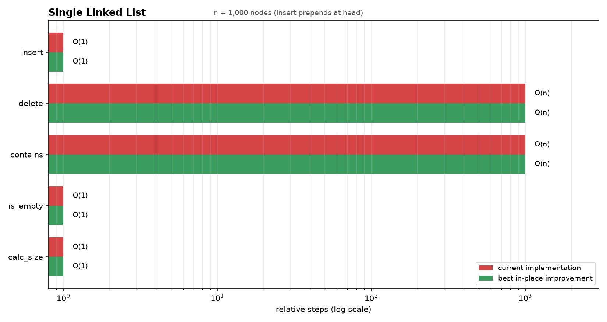
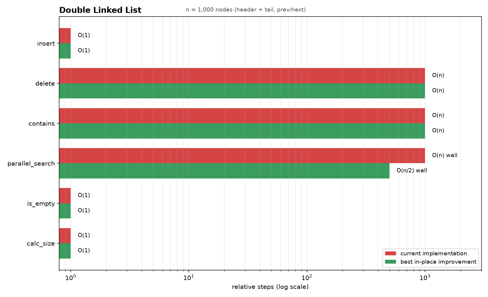
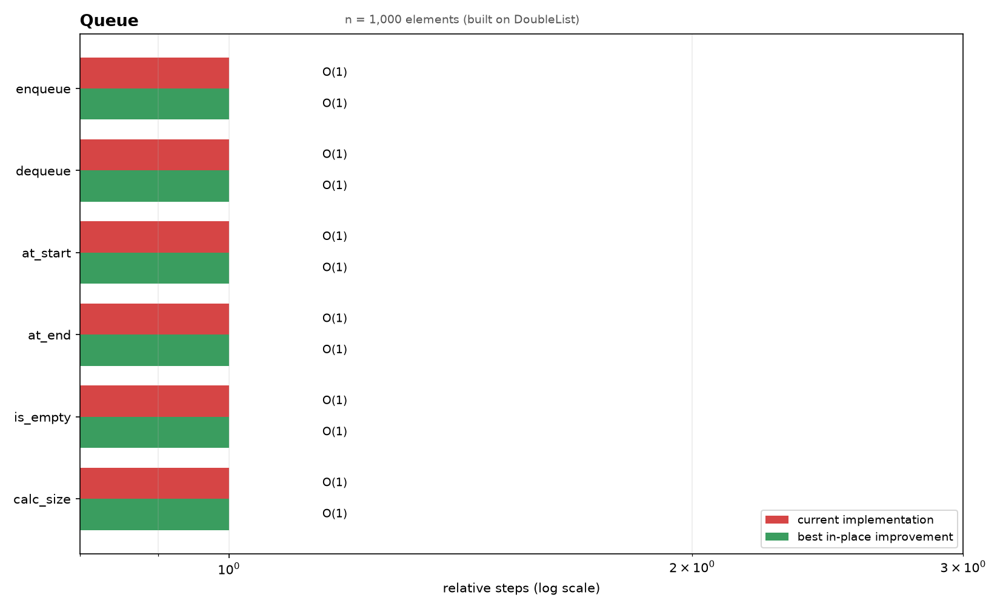
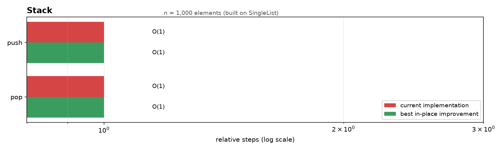
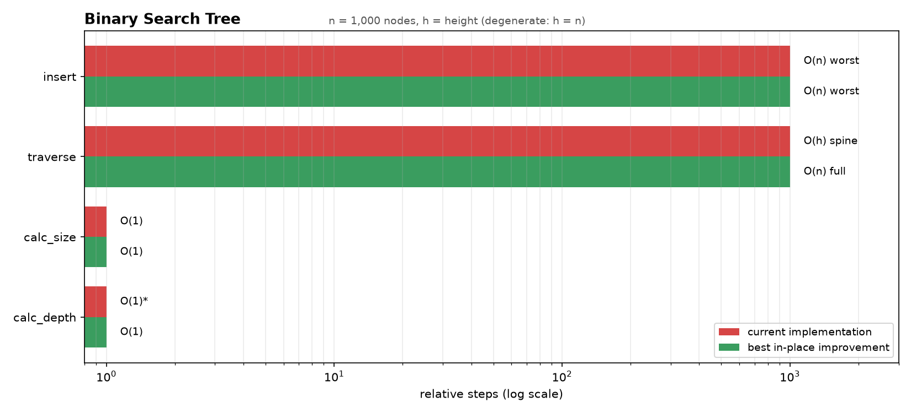
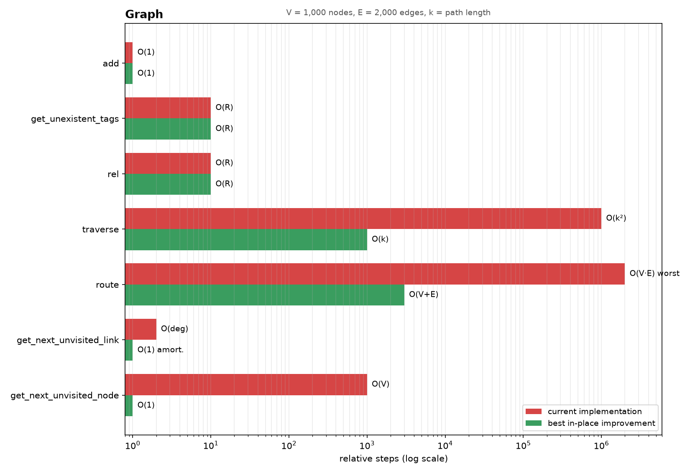

# Operation Complexity Analysis

Complexity analysis of every operation in every data structure, verified against the
actual implementations (not the textbook versions). Each table lists:

1. **Operation** — the public (and, for Graph, helper) method
2. **Expected O time** — what the implementation actually costs today
3. **Improved O time** — the best achievable cost using **in-place** changes only
   (pointers/metadata maintained during `insert`/`delete`, standard algorithm swaps;
   no auxiliary index structures)
4. **Justification** — what the code does and why the improvement is (or is not) possible

Charts comparing current vs improved cost per operation (log scale) are in
[`charts/`](charts/), generated by [`generate_charts.py`](generate_charts.py).

Verified runtime bugs that affect the analysis are listed per data structure; each was
reproduced with focused snippets or the test suite (current baseline: `36 passed /
4 failed / 9 skipped` — the skipped ones are the 1M/1k benchmark tests marked for
profiling; the failures are the three tree traverse-order tests plus the graph
`test_rel_tag_not_found`, both caused by implementation bugs described below).

> `n` = number of stored items, `h` = tree height, `V`/`E` = graph nodes/edges,
> `d` = node degree, `k` = path length, `R` = `len(ref_tags)`.

---

## Single Linked List

[`structs/list/single/single_list.py`](../structs/list/single/single_list.py)

| # | Operation | Expected O | Improved O | Justification |
|---|-----------|-----------:|-----------:|---------------|
| 1 | `insert` | O(1) | O(1) | Prepends a new `SingleNode` at `header_node`. Constant work; already optimal. |
| 2 | `delete` | O(n) | O(n) | Linear scan until `iter_node.value == value`, then pointer surgery (prev/next cases). The value position is data-dependent, so a scan is unavoidable *unless* deletion is by node reference — then splicing out a known node still needs the predecessor in a singly linked list, so O(n) stands in place. |
| 3 | `contains` | O(n) | O(n) | Linear scan of the whole chain. A singly linked list cannot do better in place; only a hash index (out of scope here) reaches O(1). |
| 4 | `is_empty` | O(1) | O(1) | `header_node is None` — constant. |
| 5 | `calc_size` | O(1) | O(1) | Returns the maintained `nodes_counter`. Already the improved design (a naive version would count nodes in O(n)). |

**Verified bug notes**

- `nodes_counter` is a **class attribute** shared by all `SingleList` instances; it
  works only because every instance mutates the same counter. Two lists created
  together corrupt each other's size.
- `delete` of the **tail** node falls through the case ladder and returns `True` via
  the final unconditional `return True` — correct by accident, but the last-node case
  (`nodes_counter = 0`) is only hit when the list had exactly one element.
- `represent` is a stub (`pass`) and returns `None` despite the `[RT]` generic.
- `print` is O(n) but excluded from the tables (display op).

### Chart

---

## Double Linked List

[`structs/list/double/double_list.py`](../structs/list/double/double_list.py)

| # | Operation | Expected O | Improved O | Justification |
|---|-----------|-----------:|-----------:|---------------|
| 1 | `insert` | O(1) | O(1) | Prepends at `header_node`, wiring `prev_node` of the old head. The `tail_node.prev_node` fix-up is constant. Already optimal. |
| 2 | `delete` | O(n) | O(1)† | Same linear scan by value as the single list. But a doubly linked node can unlink itself given a reference: with **deletion by node** (or a back-pointer to any node handed out), splicing is O(1). †O(n) remains if the API keeps deleting by value. |
| 3 | `contains` | O(n) | O(n) | Linear scan from `tail_node` backwards (or from `header_node` forwards when `reverse=True`). Bidirectional links do not beat O(n) lookup in place. |
| 4 | `parallel_search` | O(n) wall / O(2n) work | O(n/2) wall | Submits `contains` in both directions to a `ThreadPoolExecutor(2)` and takes the first winner. The runtime uses a **free-threaded CPython 3.13.1 build (GIL disabled)**, so the two scans genuinely overlap. Wall time halves; total work does not. |
| 5 | `is_empty` | O(1) | O(1) | Checks both `header_node` and `tail_node`. |
| 6 | `calc_size` | O(1) | O(1) | Returns the maintained `nodes_counter`. |

**Verified bug notes**

- `delete` of a **non-empty list where the value is absent** falls off the `while`
  loop and returns `None` instead of `False` (the single list returns `False`).
- Same shared class-attribute `nodes_counter` issue as the single list.
- `represent` is a stub.

### Chart

---

## Queue

[`structs/queue/simple_queue.py`](../structs/queue/simple_queue.py) — built on `DoubleList`

| # | Operation | Expected O | Improved O | Justification |
|---|-----------|-----------:|-----------:|---------------|
| 1 | `enqueue` | O(1) | O(1) | Delegates to `DoubleList.insert` (prepend at header). Constant. |
| 2 | `dequeue` | O(1) | O(1) | Unlinks `tail_node` directly (reads `tail_node.prev_node`, rewires). No scan — already optimal, and the reason a doubly linked backing list is the right choice here. |
| 3 | `at_start` | O(1) | O(1) | `tail_node.value`. |
| 4 | `at_end` | O(1) | O(1) | `header_node.value`. |
| 5 | `is_empty` | O(1) | O(1) | Delegates to `DoubleList.is_empty`. |
| 6 | `calc_size` | O(1) | O(1) | Delegates to the maintained counter. |

**Verified bug notes**

- `dequeue` **decrements the shared `DoubleList.nodes_counter` directly**, bypassing
  `delete`. This is why the queue drains correctly in the 1M test — but see below.
- After dequeuing **every** element, `tail_node` becomes `None` while the stale
  `header_node` still points at the removed node: `is_empty()` returns `False` and a
  subsequent `enqueue` crashes with
  `AttributeError: 'NoneType' object has no attribute 'prev_node'`
  (reproduced; `double_list.insert` touches `tail_node.prev_node`).
- `at_start`/`at_end` on an empty queue raise `AttributeError` (no guard, unlike
  `dequeue`).
- Dequeuing the last element also leaves the removed node's `prev_node` dangling
  relative to the stale header — the list invariants are not restored.

### Chart

---

## Stack

[`structs/stack/simple_stack.py`](../structs/stack/simple_stack.py) — built on `SingleList`

| # | Operation | Expected O | Improved O | Justification |
|---|-----------|-----------:|-----------:|---------------|
| 1 | `push` | O(1) | O(1) | Delegates to `SingleList.insert` (prepend at head) — the head *is* the top of the stack. Optimal. |
| 2 | `pop` | O(1) | O(1) | Reads `header_node`, advances the head. No scan. Optimal. |

(Verified: the `Stack` class exposes only `push`, `pop` and `print`; `is_empty` /
`calc_size` live on the internal `SingleList`, not on the stack itself.)

**Verified bug notes**

- Like the queue, `pop` decrements the shared `SingleList.nodes_counter` directly;
  popping a 1M-element stack works (`test_stack_with_1m_elements` passes).
- `pop` on an empty stack correctly returns `None`.
- Same shared class-attribute `nodes_counter` issue as above.

### Chart

---

## Binary Search Tree

[`structs/tree/binary_tree.py`](../structs/tree/binary_tree.py)

| # | Operation | Expected O | Improved O | Justification |
|---|-----------|-----------:|-----------:|---------------|
| 1 | `insert` | O(n) worst / O(h) typical | O(log n) amortized (balanced) | Iterative descent comparing `less()` left/right. On **sorted input the tree degenerates into a chain** (height n), matching the `test_traverse_in_order_1k_items` pattern. In-place improvement: AVL-style rotations or a red-black recolor during the descent keeps height O(log n) with O(1) work per level. Without rebalancing, worst case stays O(n). |
| 2 | `traverse` | O(h) yields — **partial** | O(n) — **complete** | The generator walks `backref_node` (parent pointers) from a starting node: `PRE_ORDER` starts at the root and yields only the **right spine**, `IN_ORDER` starts at the min and yields the **left spine**, `POST_ORDER` the right spine from the max. Reproduced: for the canonical 7-node tree it returns `[20]`, `[12, 15, 20]`, `[27, 25, 20]` instead of the full orders. The improved cost is a classic recursive left/root/right walk (iterative with an explicit stack to stay in place): O(n) touching every node once. |
| 3 | `calc_size` | O(1) | O(1) | Maintained `nodes_counter`. |
| 4 | `calc_depth` | O(1) — **wrong value** | O(n) — correct value, or O(1) if maintained | `self.depth` is initialized to 0 and **never updated** by `insert`; the 1k-node sorted-insert test asserts it stays 0. Returning the stored field is O(1) but meaningless. In place: compute height recursively O(n), or maintain `depth` during insert for O(1) correct reads. |

**Verified bug notes**

- `traverse` ignores the `node` parameter (immediately overwrites it with
  `self.root_node`) and produces **at most one root-to-leaf spine**, not a tree
  walk. All three order tests fail
  (`test_binary_tree_pre/in/post_order_traverse` in the current suite).
- `calc_depth` never reflects real depth (documented by the passing
  `test_binary_tree_one_insertion` / `test_binary_tree_insertion` asserting 0).
- `side_left_node` / `side_right_node` tracking in `insert` only serves the partial
  traverse; it disappears with a proper walk.
- The TreeNode `less()` casts values via `int(value)`, so float precision is truncated.

### Chart

---

## Graph

[`structs/graph/graph.py`](../structs/graph/graph.py), [`structs/graph/node.py`](../structs/graph/node.py)

| # | Operation | Expected O | Improved O | Justification |
|---|-----------|-----------:|-----------:|---------------|
| 1 | `add` | O(1) | O(1) | `tag_map[tag] = node` — dict insert. |
| 2 | `get_unexistent_tags` | O(R + V)† | O(R) | Set difference between the R requested tags and all stored tags. †Bounded by R + V only if the dict key view is materialized; in practice the set-build over `tag_map.keys()` is O(V). Improved: validate with `tag not in self.tag_map` per ref tag — O(R) expected, no full key set. |
| 3 | `rel` | O(R) (+ distance math) | O(R) | Cyclic check, tag lookup, unexistent-tag validation, then one `GraphLinkData` per ref (each computing Euclidean `calc_distance`). Linear in the request; optimal. Duplicates silently overwrite (`refs[ref_tag] = link_data`). |
| 4 | `traverse` | O(k²) | O(k) | Validates tags (O(V) set build), then loops `tags.pop(0)` — **`list.pop(0)` shifts the whole list every step**, quadratic in the path length. Improved: iterate with an index or `deque.popleft()` → linear walk over k links. |
| 5 | `route` | O(V·E) worst (DFS-like) | O(V + E) — BFS | Hand-rolled search: from the current node it checks `refs.get(to_tag)`, else scans `get_next_unvisited_link` and jumps; on dead ends it **resets `selected_route` to `[from_tag]`** and restarts from the next unvisited node. Without a visited-set on *nodes* it can re-explore, and worst case revisits edges → O(V·E). Improved: mark nodes visited (the `traverse_queue` dict exists but is only used for restarts), use a real FIFO queue and keep parent pointers → classic O(V + E) BFS with path reconstruction. |
| 6 | `get_next_unvisited_link` | O(d) | O(1) amortized | Scans `refs.values()` for the first `visited == False` link, rebuilding a list each call. Improved: keep a cursor per node (advance past visited links once) or pop from the dict — amortized O(1) over the whole route. |
| 7 | `get_next_unvisited_node` | O(V) | O(1) | Scans the whole `traverse_queue` dict for the first unvisited tag. Improved: maintain an ordered worklist/deque of pending tags → O(1) per extraction. |

**Verified bug notes**

- `tag_map` is a **class attribute** — every `Graph()` instance shares one map.
  Reproduced: `g1.add(...)` is visible in `g2.tag_map`. It also explains the suite's
  `test_add_1m` failing only in full-file runs (state leaks between tests) and
  `test_rel_tag_not_found` failing after 1M adds (the 1M-tag map keeps earlier
  tags like `'B'` alive).
- `route` leaves `link.visited = True` behind: the **second identical call on a
  3-node chain raises `RouteNotFoundError`** (reproduced). The one-shot behavior
  makes `route` unusable without manual flag resets — and the fix belongs in the
  BFS rewrite above (per-call visited set, no persistent flags).
- `route` raises `TagNotFoundError(from_tag, ...)` for a missing *to* tag (wrong
  variable in the message), and `NotFoundError` subclasses `BaseException`, so
  `except Exception` will not catch graph errors.
- `GraphError.__init__` prints every error message (marked debug-only in source).
- `GraphNode.copy()` shares the `refs` dict — a "copy" that aliases mutable state.

### Chart

---

## Cross-structure summary

| Data structure | Biggest win available | Root cause |
|----------------|----------------------|------------|
| Single Linked List | none (already O(1) where possible) | — |
| Double Linked List | delete-by-node → O(1); wall-time halving already real on free-threaded 3.13 | scan-by-value API |
| Queue | none for speed; **correctness** fix needed for drain-then-enqueue | stale header/None tail after full drain |
| Stack | none (already optimal) | — |
| BST | insert O(n)→O(log n) amortized with rotations; traverse must be rewritten to a real O(n) walk | degenerate chains + backref-spine "traversal" |
| Graph | traverse O(k²)→O(k); route O(V·E)→O(V+E) BFS; helpers O(V)/O(d)→O(1) | `pop(0)`, no node-visited set, linear helper scans |

### Method notes

- Runtimes verified on the project interpreter: **CPython 3.13.1 free-threaded**
  (`Py_GIL_DISABLED=1`, GIL off), which is what makes `parallel_search`'s wall-time
  claim real rather than theoretical.
- "Improved O" respects the user's in-place constraint: no hash indexes on values,
  no auxiliary maps beyond per-call bookkeeping (visited sets, deques, cursors).
- Chart bars use a log scale so O(1) vs O(n) vs O(k²) fits one axis; step counts use
  n = 1,000 (lists/queue/stack/tree) and V = 1,000, E = 2,000 (graph).
- Suite state at analysis time: **36 passed / 4 failed / 9 skipped**. The skips are
  the 1M/1k benchmark tests (marked `pytest.mark.skip` for profiling); the failures
  are the three tree traverse-order tests plus graph `test_rel_tag_not_found`.
  The graph failure is caused by the shared class-level `tag_map` — with a clean
  interpreter the same test passes in isolation, and the skipped `test_add_1m`
  fails only when other tests have polluted the shared map first.
